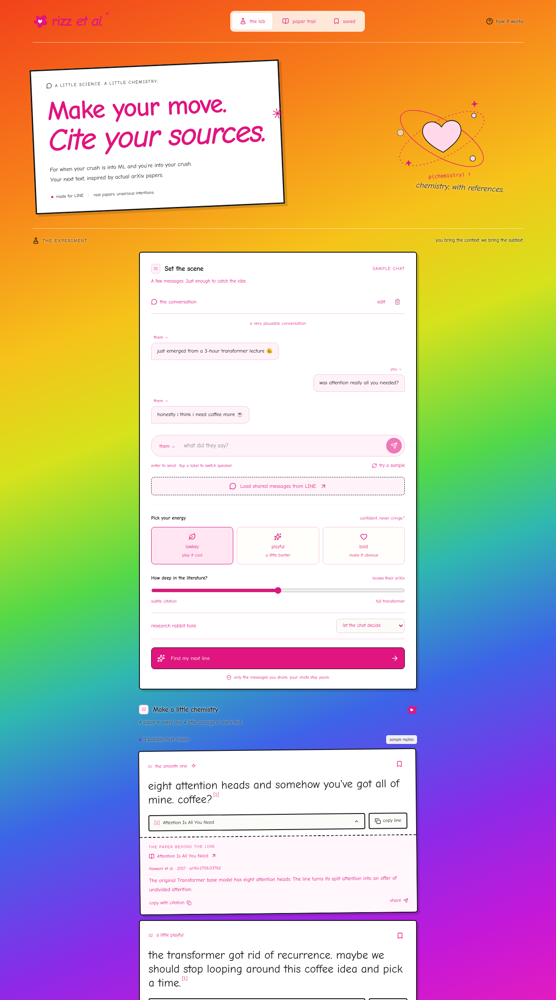

# rizz et al.

**Make your move. Cite your sources.**

rizz et al. is a LINE mini app that helps you text your crush when your crush is into machine learning. Forward a few messages from the conversation to the bot, and the app writes three short, lightly flirty replies. Each one riffs on a specific idea from a real ML paper and cites it with a working arXiv link.

Built at Tokyo AgentForge on November 14, 2026.



The look matches our pitch deck: a rainbow background, Comic Sans, hot-pink headings, and white cards with black borders. The lab runs as one column, so it reads the same on a phone in LINE as on a laptop.

## What it does

- **Reads only what you share.** The app can't see LINE history. You forward the messages you want help with to the bot, or type them into the chat bar under the conversation: pick "them" or "you", type, and press Enter. Tap a speaker label to fix who said what.
- **Writes three replies.** You pick an energy (lowkey, playful, or bold), how deep into the literature to go (subtle citation to full transformer), and a research topic, or let the chat pick one.
- **Cites every line, like a paper.** Each reply ends with a footnote marker such as `[1]`, and the footnote under it names the paper. Tap the footnote to see the authors, the arXiv ID, and how the line uses the paper, such as LoRA's frozen weights or the Transformer's eight attention heads. You can copy a line, copy it with the citation, share it through LINE, or save it for later.
- **Backs off on a no.** If their last message sets a boundary, like "not interested" or "please stop", the app writes no lines and offers a considerate reply instead.

## How a reply is made

1. **Pick a topic.** With "let the chat decide", keywords in the conversation choose one of five topics: attention and transformers, diffusion, LoRA and meta-learning, scaling and generalization, or alignment and RLHF.
2. **Find papers.** When AI is on, [Tavily](https://tavily.com) searches arxiv.org for papers on that topic. The server then fetches the papers' real titles, authors, and abstracts from the arXiv API, keeping only ML categories. Without Tavily, the server queries arXiv for a fixed set of well-known titles. If arXiv is unreachable, it uses a built-in library of nine verified papers. Only the topic is searched; chat text never goes to Tavily or arXiv.
3. **Write the replies.** OpenAI's Responses API (`gpt-4.1-mini` by default, structured output, `store: false`) gets the conversation and the papers. The prompt requires every line to use a concrete detail from its paper, not a buzzword attached to a generic pickup line, and to keep fact and metaphor apart.
4. **Check the citations.** The model can cite only the paper IDs it was given; the response schema enforces this, and the server checks it again. Any reply that cites something else is rejected.
5. **Fall back gracefully.** Without an OpenAI key, or if generation fails, the app serves hand-written replies for the topic, labeled as crafted examples.

## Partner tech

- **Tavily** finds arXiv papers for each topic, so replies can draw on more than the built-in library. See `tavilyArxivIds` and `findPapers` in [`line-miniapp/lib/rizz/papers.ts`](line-miniapp/lib/rizz/papers.ts).

## Stack

- Next.js App Router on [vinext](https://github.com/cloudflare/vinext), running as a Cloudflare Worker
- Cloudflare D1 with Drizzle for forwarded messages and rate limits
- LINE Messaging API webhook for the bot, and LIFF for the in-LINE app and sign-in
- OpenAI Responses API, Tavily Search, and the arXiv API
- Tailwind CSS and shadcn/ui

## Repository layout

```text
line-miniapp/
  app/page.tsx               the whole UI: the lab, the paper trail, saved lines
  app/api/generate/          topic choice, paper search, AI generation, fallback
  app/api/line/webhook/      LINE bot: stores forwarded text, handles /open and /clear
  app/api/context/           returns or deletes a verified user's forwarded messages
  app/api/papers/            the built-in paper library
  lib/rizz/papers.ts         paper library, Tavily and arXiv search, caching
  lib/rizz/generate.ts       OpenAI prompt, citation checks, crafted replies, boundary check
  lib/rizz/server.ts         LIFF token check, webhook signature, rate limiting
  db/schema.ts, drizzle/     D1 schema and migrations
```

## Run it

```sh
cd line-miniapp
npm ci
npm run dev
```

The sample conversation works with no credentials. Add `OPENAI_API_KEY` and `TAVILY_API_KEY` to `line-miniapp/.dev.vars` for AI-tailored replies with Tavily paper search. [`line-miniapp/README.md`](line-miniapp/README.md) covers every setting, connecting a LINE bot, the local database, and privacy details.

## Privacy

- Forwarded messages are tied to a LINE identity the server verifies with LINE. Each user keeps at most the latest 12, and they expire after 24 hours. `/clear` deletes them at any time.
- Messages typed in the browser are never stored.
- With AI on, the selected messages go to OpenAI with storage disabled. Search services only see the research topic.
- Verified LINE users are limited to 10 AI requests per minute.
- The app never sends anything for you.
